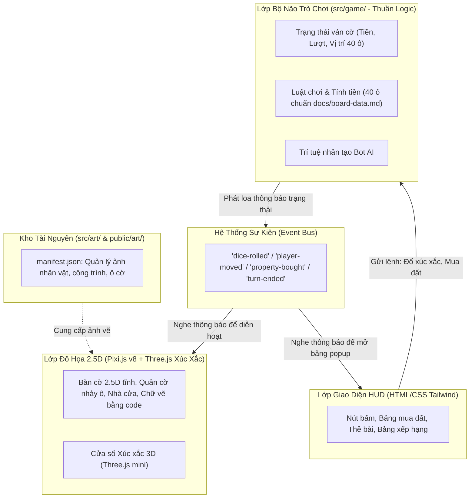

# BÁO CÁO TOÀN DIỆN DỰ ÁN & KẾ HOẠCH NÂNG CẤP CỜ TỶ PHÚ v2 (2.5D)

> **Mục tiêu:** Báo cáo phân tích hiện trạng dự án, đánh giá tính khả thi của "bộ não" trò chơi, đề xuất kiến trúc hệ thống phiên bản v2 (Đồ họa 2.5D phong cách Meta World) và lộ trình triển khai chi tiết cho các bước tiếp theo. Văn bản được viết bằng ngôn ngữ trực quan, dễ hiểu dành cho người quản lý không chuyên về kỹ thuật lập trình.

---

## 1. Cấu Trúc Hiện Tại Của Dự Án

### 1.1. Công nghệ đang sử dụng
* **Nền tảng trang web (Web Framework):** Next.js 14 kết hợp React 18 và TypeScript.
* **Đồ họa hiển thị hiện tại (Graphics):** Three.js (thư viện đồ họa 3D) và React Three Fiber. Toàn bộ bàn cờ, tiểu cảnh diorama hồ Hoàn Kiếm, nhân vật và nhà cửa hiện đang được dựng bằng các khối hình học 3D thời gian thực.
* **Giao diện người dùng (UI / HUD):** HTML/CSS dựng bằng Tailwind CSS, hiển thị dạng các lớp đè (overlay) phía trên bàn cờ 3D.
* **Hệ thống âm thanh (Audio):** Tự phát triển dựa trên chuẩn Web Audio API (quản lý nhạc nền BGM phố cổ, âm thanh xúc xắc, mua đất, nâng cấp nhà).
* **Chế độ chơi nhiều người (Multiplayer):** Công nghệ PeerJS (WebRTC P2P), cho phép các thiết bị người chơi tự kết nối trực tiếp với nhau mà không cần thuê máy chủ trung gian tốn kém.
* **Hệ thống kiểm thử tự động (Unit Test):** Vitest. Hiện dự án có **211 bài kiểm tra tự động** đang chạy và đều vượt qua 100%.

### 1.2. Các phân hệ chính và danh sách file phụ trách

| Phân hệ | Nhiệm vụ chính | File code phụ trách |
| :--- | :--- | :--- |
| **Dữ liệu ô bàn cờ** | Lưu thông tin từng ô (tên thành phố, giá đất, tiền nhà, vị trí góc). | Hiện tại là `src/lib/game-engine/boardData.ts` (32 ô cũ). Tài liệu chuẩn mới là `docs/board-data.md` (40 ô mới). |
| **Bộ não luật chơi & Tính tiền** | Xử lý vòng chơi, đổ xúc xắc, tính quãng đường đi, cộng/trừ tiền thưởng, phạt tù, tính tiền thuê đất, nâng cấp nhà, thế chấp và phá sản. | `src/lib/game-engine/gameStore.ts` (1.627 dòng) và `src/lib/game-engine/types.ts`. |
| **Thẻ bài vận mệnh** | Các lá bài rút ngẫu nhiên khi vào ô Cơ Hội / Khí Vận. | `src/lib/game-engine/chanceCards.ts` (24 lá bài dân gian). |
| **Trí tuệ nhân tạo (Bot AI)** | Tự động hóa lượt chơi cho Bot, tính toán xem có nên mua đất không, nâng cấp nhà nào lời nhất, có nên nộp tiền ra tù không. | `src/lib/game-engine/botAI.ts`. |
| **Hiển thị 3D hiện tại** | Dựng khung bàn cờ 3D, tiểu cảnh hồ nước, quân cờ mascot 3D, các khối nhà 3D, xúc xắc 3D. | Thư mục `src/components/games/co-ty-phu/board-3d/` (`BoardCanvas.tsx`, `BoardTiles3D.tsx`, `Buildings3D.tsx`, `MascotPawns3D.tsx`, `MiniWorldDiorama3D.tsx`, `Dice3D.tsx`). |
| **Giao diện tương tác (HUD)** | Nút đổ xúc xắc, thanh thông tin người chơi, bảng mua đất/nâng cấp, bảng rút thẻ, bảng kết thúc ván. | Thư mục `src/components/games/co-ty-phu/hud/` (`CoTyPhuHUD.tsx`, `DiceControlPanel.tsx`, `PropertyActionModal.tsx`, `PlayerListBar.tsx`, v.v.). |
| **Đấu mạng nhiều người** | Kết nối phòng chơi P2P, đồng bộ trạng thái giữa máy chủ phòng và người chơi. | Thư mục `src/lib/multiplayer/` (`peerService.ts`, `roomStore.ts`). |

---

## 2. Đánh Giá "Bộ Não" Của Game (Luật chơi, Tính tiền, Lượt, Bot, Thẻ)

### 2.1. Bộ não có tách riêng khỏi phần hiển thị không?
* **Độc lập về mặt thuật toán:** Các file luật chơi (`gameStore.ts`, `botAI.ts`) không bị dính mã vẽ đồ họa 3D. Chúng chỉ chứa các phép toán cộng trừ tiền, gán dữ liệu và xử lý mảng.
* **Tuy nhiên chưa tách biệt hoàn toàn:** Bộ não hiện tại đang sử dụng thư viện Zustand gắn chặt với vòng đời của React. Giao diện đang "lắng nghe" bộ não bằng cách đọc trực tiếp toàn bộ dữ liệu. Khi có bất kỳ thay đổi nhỏ nào, giao diện phải tự tính toán lại. Dự án đang thiếu một hệ thống phát tín hiệu sự kiện chuẩn (Event Bus) để nói cho đồ họa biết *cụ thể vừa có chuyện gì xảy ra* (ví dụ: "Người chơi 1 vừa bước 4 bước", "Người chơi 2 vừa mua ô Đà Nẵng").

### 2.2. Các lỗi và bất cập rõ ràng phát hiện được
1. **Lệch cấu trúc bàn cờ (32 ô cũ so với 40 ô mới):**
   * Trong `gameStore.ts`, mã nguồn đang bị **cố định cứng (hardcode) công thức chia lấy dư cho 32**: `newPos = rawPos % 32;`.
   * Vị trí Trại Giam bị gán cứng vào ô số 8 (`activePlayer.position = 8;`).
   * Trong khi đó, theo tài liệu chuẩn thiết kế mới [docs/board-data.md](file:///d:/Antigravity/Game%20d%C3%A2n%20gian/docs/board-data.md), bàn cờ chuẩn v2 có **40 ô**:
     * Ô 0: Xuất Phát.
     * Ô 10: Trại Giam / Thăm tù (không phải ô 8).
     * Ô 20: Quán Trà Đá nghỉ chân (không phải ô 16).
     * Ô 30: Vào Tù (không phải ô 24).
     * Ô 4 & 38: Các ô Thuế thu nhập và Thuế xa xỉ.
   * *Hậu quả nếu để nguyên:* Người chơi đi đến ô 32 sẽ bị dịch chuyển ngay về ô 0, toàn bộ 8 ô vùng Bắc Bộ và Thủ đô Hà Nội sẽ bị "biến mất", không bao giờ đi tới được.
2. **Thẻ Cơ Hội bị lệch đích đến:**
   * Trong `chanceCards.ts`, một số thẻ bài dịch chuyển nhân vật tới địa danh cụ thể bị gắn sai số ô (ví dụ thẻ đi Nội Bài gắn ô 27, thẻ đi Sa Pa gắn ô 23 vì dựa trên bàn cờ 32 ô cũ).
3. **Nhân vật không đúng với định hướng Việt Nam hóa v2:**
   * Hệ thống cũ dùng mascot thú hoạt hình (Bé Heo, Bé Cáo, Bé Mèo, Bé Trâu).
   * Luật v2 trong `GEMINI.md` quy định 4 nhân vật chuẩn thuần Việt: **Bé Tí (Đỏ), Cô Hoa (Xanh ngọc), Ông Bảy (Vàng), Chị Mây (Tím)**. Các hình ảnh nhân vật này đã được chuẩn bị sẵn trong thư mục tài nguyên.

### 2.3. Đề xuất: GIỮ LẠI VÀ TÁCH THÀNH MODULE RIÊNG hay VIẾT LẠI?
* **ĐỀ XUẤT CHÍNH THỨC: GIỮ LẠI BỘ KHUNG LOGIC VÀ TÁCH RA MODULE RIÊNG (`src/game/`), KHÔNG VIẾT LẠI TỪ ĐẦU.**
* **Giải thích bằng lời dễ hiểu:**
  * Hãy hình dung luật chơi giống như một bộ động cơ xe máy. Các bánh răng bên trong như:
    * Công thức tính tiền thuê đất nhân đôi khi gom đủ cụm màu.
    * Quy trình trừ nợ, thanh lý nhà và xử lý khi người chơi bị phá sản.
    * Trí tuệ của Bot: biết tự cân nhắc khi nào nên mua đất, khi nào nên tiết kiệm tiền, khi nào nên nộp tiền ra tù.
  * Toàn bộ các cơ chế phức tạp này **đều đã chạy rất mượt mà và vượt qua 211 bài kiểm thử tự động**. Nếu đập đi viết lại từ con số 0, chúng ta sẽ rất dễ gặp phải các lỗi sơ đẳng (như bị trừ tiền âm, bot bị đơ, tính sai tiền khi phá sản).
  * Do đó, giải pháp khôn ngoan và an toàn nhất là: **"Giữ lại toàn bộ ruột máy xịn, chuyển vào một hộp kín riêng biệt (`src/game/`), sau đó chỉ thay đổi các thông số cho khớp với bàn cờ 40 ô mới"**.

---

## 3. Kiến Trúc v2 Đề Xuất (Phân Tách 4 Lớp Chuyên Biệt)

Mô hình kiến trúc mới giúp game cực kỳ nhẹ, đồ họa 2.5D sắc nét, không bị giật lag và dễ bảo trì:

### 3.1. Thư mục `src/game/` (Bộ não trung tâm - Không phụ thuộc đồ họa)
* **Đặc tính:** Viết bằng TypeScript thuần túy, tuyệt đối không chứa mã giao diện, không import thư viện đồ họa hay React.
* **Thành phần:**
  * `board.ts`: Dữ liệu 40 ô chuẩn hóa lấy từ `docs/board-data.md`.
  * `rules.ts`: Bộ quy tắc tính tiền thuê, tính thuế (-200k, -100k), luật vào tù/ra tù, nhân đôi tiền cụm màu.
  * `state.ts`: Quản lý danh sách người chơi (Bé Tí, Cô Hoa, Ông Bảy, Chị Mây), tiền mặt, tài sản sở hữu.
  * `bot.ts`: Thuật toán suy nghĩ của Bot.
  * `events.ts`: Bộ phát tín hiệu (Event Emitter).

### 3.2. Thư mục `src/renderer25d/` (Lớp đồ họa Pixi.js v8)
* **Đặc tính:** Sử dụng Pixi.js v8 vẽ đồ họa 2.5D dạng phối cảnh xéo (isometric).
* **Hiệu năng cao:** Áp dụng cơ chế **Render on demand** (chỉ vẽ lại khung hình khi có chuyển động quân cờ, lăn xúc xắc hoặc khi người chơi kéo chuột/phóng to thu nhỏ). Đảm bảo đạt mốc **60 FPS** nhẹ nhàng trên laptop văn phòng và điện thoại phổ thông.
* **Camera cố định:** Góc nhìn xiên cố định bao quát toàn cảnh bàn cờ và hồ Hoàn Kiếm, hỗ trợ kéo rê (pan) và phóng to/thu nhỏ trong khoảng `0.8x - 1.6x`, không quay 360 độ giúp người chơi không bị chóng mặt.
* **Vẽ chữ bằng code:** Toàn bộ tên phố (Hà Nội, Hội An, Cần Thơ...) và số tiền trên từng ô cờ được vẽ trực tiếp bằng mã nguồn thông qua 2 bộ font chuẩn: *Be Vietnam Pro* và *Baloo 2*, tuyệt đối không ghép chữ chết vào ảnh.
* **Phần xúc xắc 3D:** Giữ lại một khung nhỏ Three.js chỉ bật lên khi lắc và đổ xúc xắc, sau đó tự tắt đi để tiết kiệm pin.

### 3.3. Thư mục `src/ui/` (Lớp giao diện HUD bằng HTML/CSS)
* Đè trực tiếp lên trên canvas của Pixi.js.
* Gồm các thanh trạng thái: số tiền, chân dung nhân vật đang chơi, danh sách người chơi, nút đổ xúc xắc vàng cam rực rỡ, các hộp thoại mua đất và rút thẻ.
* Tuân thủ luật dự án: **Không dùng thuộc tính làm mờ kính (`backdrop-filter`)** vì gây tụt khung hình (drop FPS) nghiêm trọng trên các dòng điện thoại tầm trung.

### 3.4. Thư mục `src/art/` (Kho tài nguyên ảnh và bản đồ ảnh)
* Quản lý qua file `src/art/manifest.json`.
* Nạp ảnh từ thư mục `public/art/` đã được cắt sẵn:
  * Ảnh 4 nhân vật (Bé Tí, Cô Hoa, Ông Bảy, Chị Mây).
  * Ảnh công trình kiến trúc biểu tượng từng vùng miền (Tháp Rùa, Chợ Bến Thành, Ngọ Môn Huế, Cầu Rồng Đà Nẵng, Nhà thờ đá Sa Pa...).
* **Cơ chế an toàn (Fallback):** Nếu một ảnh nào đó bị thiếu hoặc tải chậm, hệ thống tự động vẽ một hình khối màu tạm thời tương ứng, game vẫn chơi tiếp bình thường mà không bao giờ bị dừng đột ngột.

### 3.5. Cơ chế giao tiếp qua Sự kiện (Event Pipeline)
* Bộ não đóng vai trò như **"Trọng tài điều hành"**, còn Pixi.js và HUD đóng vai trò như **"Đội ngũ diễn viên & Sân khấu"**:
  1. Người chơi ấn nút "Đổ xúc xắc" trên HUD -> Gửi lệnh vào Bộ não.
  2. Bộ não tính ra kết quả `[3, 4]`, sau đó phát loa: sự kiện `"dice-rolled"`.
  3. Xúc xắc 3D nghe thấy loa liền diễn hoạt lăn xúc xắc rơi ra 3 và 4.
  4. Bộ não phát tiếp loa: sự kiện `"player-moved"` (đi từ ô 0 tới ô 7).
  5. Pixi.js nghe thấy loa sẽ cho quân cờ nhảy từng bước trên bàn cờ 2.5D.
  6. Khi quân cờ chạm đất, bộ não phát loa: sự kiện `"tile-landed"` tại ô số 7.
  7. HUD nghe thấy loa liền bật bảng popup: *"Bạn có muốn mua ô này với giá 100k không?"*.
  8. Người chơi chọn "Mua" -> Bộ não trừ tiền, gán đất, rồi phát loa `"property-bought"` -> Pixi.js lập tức cắm cờ và dựng nhà lên ô đất đó.

---

## 4. Danh Sách Các Bước Thực Hiện Tiếp Theo & Ước Lượng Độ Khó

| Bước | Tên công việc | Chi tiết công việc cần làm | Ước lượng độ khó | Rủi ro & Lưu ý |
| :---: | :--- | :--- | :---: | :--- |
| **1** | **Chuẩn hoá Bộ não 40 ô (`src/game/`)** | - Tách logic lõi sang `src/game/`. - Cập nhật dữ liệu 40 ô theo `docs/board-data.md`. - Đổi vị trí Tù (ô 10), Nghỉ chân (ô 20), Vào Tù (ô 30), Thuế (ô 4, ô 38). - Cập nhật 4 nhân vật Việt Nam (Bé Tí, Cô Hoa, Ông Bảy, Chị Mây). | **Trung bình** (3/5) | Rủi ro thấp vì chỉ cần tỉ mỉ đối chiếu từng thông số, giữ nguyên các công thức tính toán sẵn có. |
| **2** | **Cài đặt Pixi.js v8 & Khởi tạo Bàn cờ 2.5D** | - Cài đặt thư viện `pixi.js` v8 vào dự án. - Thiết lập khung vẽ 2.5D phối cảnh isometric, camera kéo và zoom `0.8x - 1.6x`. - Vẽ khung bàn cờ 40 ô và tiểu cảnh Tháp Rùa. - Thiết lập cơ chế Render on demand và vẽ chữ số bằng code font Be Vietnam Pro / Baloo 2. | **Khá cao** (4/5) | Cần tính toán góc tọa độ xéo (isometric) chính xác để 40 ô xếp đều đặn thành hình vuông cân đối. |
| **3** | **Hiển thị Nhân vật & Công trình lên Bàn cờ 2.5D** | - Nạp ảnh nhân vật và công trình từ `public/art/` qua `src/art/manifest.json`. - Hiển thị quân cờ 4 người chơi. - Làm chuyển động nhảy từng bước khi quân cờ di chuyển. - Hiển thị cờ sở hữu, nhà cấp 1, 2, 3 và Landmark biểu tượng theo từng ô. | **Khá cao** (4/5) | Cần sắp xếp thứ tự hiển thị (z-index) thật chuẩn để nhà phía trước không bị nhân vật hay nhà phía sau đè nhầm lên. |
| **4** | **Tách riêng Xúc xắc 3D (Three.js mini)** | - Rút gọn Three.js chỉ để hiển thị riêng 2 con xúc xắc 3D nhỏ gọn. - Khi có lệnh đổ xúc xắc, khung 3D hiện lên tung xúc xắc và biến mất khi xong lượt để tiết kiệm tài nguyên máy. | **Dễ** (2/5) | Đã có sẵn mã xúc xắc 3D từ phiên bản trước, chỉ cần đóng gói thành một thành phần độc lập. |
| **5** | **Kết nối Giao diện HUD với Hệ thống Sự kiện** | - Nối các nút bấm trên màn hình với Event Bus của bộ não. - Cập nhật chân dung 4 nhân vật (Bé Tí, Cô Hoa, Ông Bảy, Chị Mây). - Loại bỏ toàn bộ hiệu ứng mờ kính `backdrop-filter` để đảm bảo mượt mà. | **Trung bình** (3/5) | Cần đảm bảo giao diện hiển thị vừa vặn, đẹp mắt trên cả màn hình máy tính và điện thoại. |
| **6** | **Tích hợp toàn diện, Chạy thử & Đo đạc FPS** | - Ghép nối toàn bộ ván đấu hoàn chỉnh giữa người chơi và 3 Bot máy. - Kiểm tra đủ các tình huống: mua đất, nâng cấp nhà, rút thẻ, đi tù, phá sản. - Mở trình duyệt đo đạc tốc độ khung hình (FPS) đảm bảo luôn đạt mốc 60 FPS. - Chụp ảnh màn hình báo cáo hoàn thành. | **Trung bình** (3/5) | Cần kiểm tra kỹ để không bỏ sót trường hợp hiếm gặp nào trong ván đấu. |

---

> [!NOTE]
> Báo cáo này đã được hoàn thiện và lưu trữ tại [docs/plan-v2.md](file:///d:/Antigravity/Game%20d%C3%A2n%20gian/docs/plan-v2.md). Tuyệt đối chưa có bất kỳ file mã nguồn nào bị thay đổi theo đúng chỉ thị ban đầu. Kế hoạch này đang chờ bạn xem xét và phê duyệt trước khi tiến hành Bước 1.
